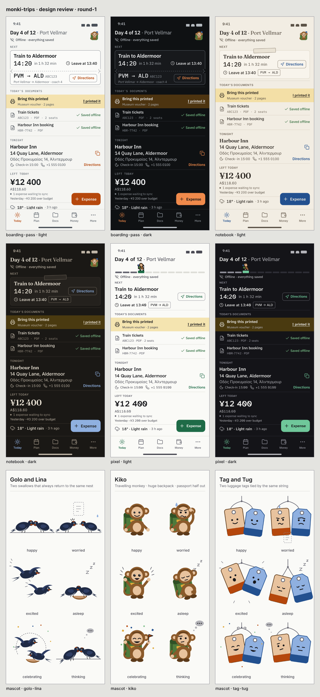

# Design review · round-1

Rendered by `scripts/design-shots.mjs` at 390×844, DPR 3, with every
non-`file://` request blocked. `index.png` is the contact sheet.

## Directions

- `boarding-pass-light.png` · boarding-pass · light
- `boarding-pass-dark.png` · boarding-pass · dark
- `notebook-light.png` · notebook · light
- `notebook-dark.png` · notebook · dark
- `pixel-light.png` · pixel · light
- `pixel-dark.png` · pixel · dark

## Mascots

- `mascot-golo-lina.png` · mascot · golo-lina
- `mascot-kiko.png` · mascot · kiko
- `mascot-tag-tug.png` · mascot · tag-tug

## Contact sheet

